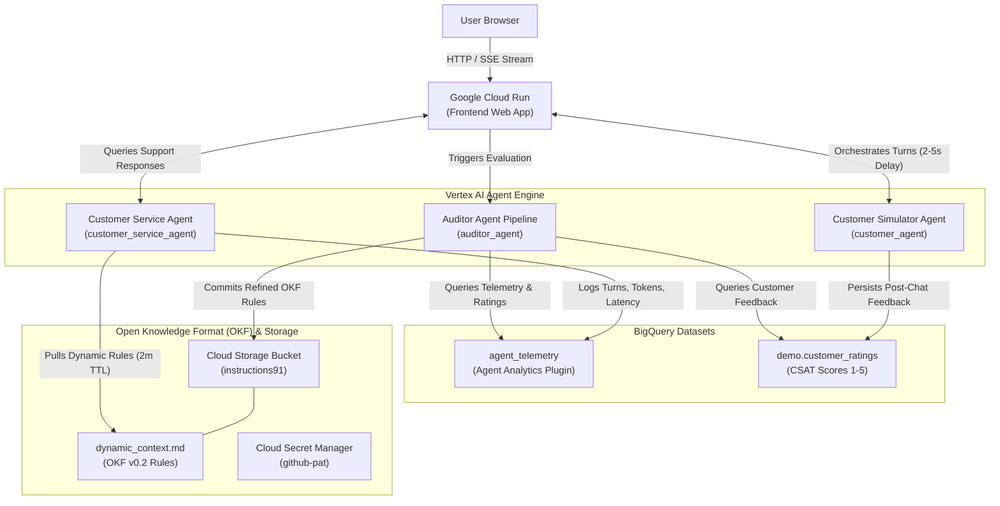

# Self-Improving Agent Feedback Loop & Dynamic Context Demonstration

An end-to-end, enterprise-grade demonstration of an **Autonomous Agent Feedback Loop and Self-Improving Agent System** built with **Google Agent Development Kit (ADK 2.0)**, **Gemini 3.8 Flash**, **Vertex AI Agent Engine**, **BigQuery**, **Cloud Secret Manager**, and **Cloud Run** for an electronics and home appliances e-commerce platform (**ApexHome & Electro**).

> [!IMPORTANT]
> **Agent Engine Logging & Observability Requirements:** In order to enable logging, telemetry, and Observability settings in Vertex AI Agent Engine (preventing the "Observability settings are not available for this agent" error), ensure all agents use `google-cloud-aiplatform[agent_engines]` ≥ v1.126.1 and `google-adk` ≥ v1.18.0, and are deployed with `--otel_to_cloud` / `GOOGLE_CLOUD_AGENT_ENGINE_ENABLE_TELEMETRY=true`.

---

## 1. System Architecture



---

## 2. End-to-End Data Flow

## 2. End-to-End Data Flow

1. **Live Customer Interaction (Dynamic & Human-Like Simulation):**
   * The user clicks **"Start conversation"** in the web interface.
   * The **Customer Simulator Agent** dynamically generates a completely novel customer persona live via `gemini-3.8-flash` on every trigger across 20+ problem categories, 22 product domains, and real-world stakes.
    * The simulator exchanges messages with the **Customer Service Agent** across an extensive **6–8 turn back-and-forth dialogue** with realistic **human chat pacing (~5–7s per turn, with typing indicators)**, streamed in real time via **Server-Sent Events (SSE)**.
   * **Agent Instruction Inspection ("Show instructions"):**
     * The frontend provides a **"Show instructions"** button in the Live Conversation tab.
     * Clicking it invokes `/api/agent/instructions`, which queries the Customer Service Agent (`customer_service_agent.agent.get_instructions()`) to fetch its full system prompt.
     * The retrieved instructions include base operational policies from `AGENT.md`, active dynamic directives loaded from the Open Knowledge Format (`dynamic_context.md`) on GitHub, and strict response style mandates.
     * Instructions are presented in an accessible modal dialog with copy functionality and dynamic OKF status indicators, as well as an inline viewer.
   * **Human-Like Customer Service Communication (Baseline Friction vs. Post-Audit Improvement):**
     * **Strict Sentence Limit:** Customer service responses are strictly capped at maximum **2 to 3 sentences** per turn, mirroring concise live support chat messaging.
     * **Plain Text Only:** Zero markdown bolding (`**`) and zero long dashes (`—`, `–`, `--`).
     * **Initial Baseline Demeanor & Gatekeeping (Pre-Audit):** When no Dynamic OKF Directives are active, the agent behaves like a dry, strictly procedural support rep who withholds immediate tool-generated fee waivers or hassle-free approvals on early turns, insists on DIY troubleshooting first, enforces the 15% open-box restocking fee and 48-hour carrier trace waits, and offers only reluctant, string-attached resolutions after customer pushback.
     * **Post-Audit Improvement (OKF Directives Active):** Once the Auditor Agent's corrective OKF rules are merged into `main`, they supersede baseline gatekeeping and friction, guiding the agent to proactively issue RMAs, waive restocking/freight fees on defects or exchanges, schedule technicians, and resolve issues smoothly.
   * The **Agent Analytics Plugin** automatically captures token counts, response latencies, tool calls, and error states into BigQuery dataset `agent_telemetry`.
2. **Realistic Customer Feedback Persistence:**
   * Upon dialogue conclusion, the Customer Agent evaluates the conversation transcript itself on a 1–5 scale (naturally producing lower 2-star and 3-star ratings during baseline friction, and improving to 4-star and 5-star ratings after Auditor rules are active) and commits the rating, feedback description, and submission timestamp to BigQuery table `demo.customer_ratings`.
3. **Auditor Multi-Agent Inspection:**
   * The user triggers **"Run Auditor Agent"**.
   * A 3-stage sequential multi-agent pipeline analyzes the actual customer ratings and telemetry in BigQuery:
     * *Telemetry & Feedback Analyzer Sub-Agent:* Detects real customer complaints (restocking fee surprises, delivery trace delays, repetitive diagnostics).
     * *Token Efficiency Optimizer Sub-Agent:* Devises prompt and completion token compression directives (-32% savings) focused on consolidating multi-turn diagnostics and disclosing return conditions upfront.
     * *OKF Rule Author Sub-Agent:* Formulates valid **Open Knowledge Format (OKF v0.2)** directives.
4. **Self-Improving Dynamic Context Update & Storage Lifecycle:**
   * The Auditor persists rules to Google Cloud Storage bucket `instructions91` (`US` multi-region):
     * **Bucket Auto-Provisioning:** If bucket `instructions91` does not exist, it is created automatically.
     * **Direct Rule Merging:** The Auditor reads existing rules from `gs://instructions91/dynamic_context.md`, appends newly formulated policies and directives, and saves the file directly.
5. **Immediate Dynamic Injection:**
   * On subsequent conversation turns, the Customer Service Agent retrieves `dynamic_context.md` from `gs://instructions91` (via TTL caching) and merges the rules into its system prompt, preventing repeat mistakes and conserving tokens without requiring redeployment.
6. **Analytics Dashboard:**
   * The user navigates to **Tab 2** (Visualization & Telemetry Analytics Dashboard) to observe real-time CSAT distributions (1 to 5 stars), response latency trends over time, token consumption over time (prompt, completion, and total tokens), tool usage breakdowns, and turn-by-turn token consumption.

---

## 3. Dependencies, Telemetry & Agent Engine Observability

In order to enable logging, telemetry, and Observability settings in Vertex AI Agent Engine, ensure all agents are configured with:
* `google-cloud-aiplatform[agent_engines]` ≥ v1.126.1
* `google-adk` ≥ v1.18.0
* OpenTelemetry reporting enabled via `--otel_to_cloud` and environment variables `GOOGLE_CLOUD_AGENT_ENGINE_ENABLE_TELEMETRY=true` and `ADK_CAPTURE_MESSAGE_CONTENT_IN_SPANS=false`.

These version baselines and telemetry flags enable native execution tracing, OpenTelemetry span collection, Cloud Trace export, container stdout/stderr capture, and structured log streaming to Cloud Logging from within Vertex AI Agent Engine.

All agent components maintain these requirements in their respective `requirements.txt` files:
```text
google-cloud-aiplatform[agent_engines]>=1.126.1
google-adk>=1.18.0
```

---

## 4. Repository Structure

```text
.
├── README.md                          # Root documentation + Mermaid architecture diagram
├── AGENT.md                           # Master agent ecosystem specification & Secret Manager auth
├── PLAN.md                            # Autonomous build and deployment specification
├── deploy_terraform.sh                # Executable script automating full Terraform deployment
├── terraform/                         # Terraform Infrastructure as Code configuration
│   ├── versions.tf                    # Provider versions and Terraform baseline
│   ├── variables.tf                   # Input variables, defaults, and type definitions
│   ├── main.tf                        # APIs, IAM, BigQuery, Secrets, Artifact Registry, Cloud Run
│   ├── outputs.tf                     # Deployed URLs, BigQuery tables, and Agent IDs
│   ├── terraform.tfvars               # Active project parameter assignments
│   ├── terraform.tfvars.example       # Template parameter file
│   └── README.md                      # Detailed Terraform usage guide
├── customer_service_agent/
│   ├── AGENT.md                       # Instructions, 2-3 sentence limit, plain text, and conflict rules
│   ├── README.md                      # Component overview, telemetry config, and deployment steps
│   ├── agent.py                       # ADK 2.0 agent + Agent Analytics Plugin + GitHub OKF loader
│   ├── deploy.py                      # Script to deploy agent to Vertex AI Agent Engine (--otel_to_cloud)
│   └── requirements.txt               # Component dependencies (aiplatform[agent_engines] >= 1.126.1, adk >= 1.18.0)
├── customer_agent/
│   ├── AGENT.md                       # Simulator instructions, persona catalog, and termination rules
│   ├── README.md                      # Component overview, BigQuery rating schema, and deployment steps
│   ├── agent.py                       # ADK 2.0 customer simulator + human pacing + BigQuery writer
│   ├── deploy.py                      # Script to deploy agent to Vertex AI Agent Engine (--otel_to_cloud)
│   └── requirements.txt               # Component dependencies (aiplatform[agent_engines] >= 1.126.1, adk >= 1.18.0)
├── auditor_agent/
│   ├── AGENT.md                       # Audit criteria, token optimization heuristics, and OKF rules
│   ├── README.md                      # Component overview, BigQuery/GitHub integration, and deployment
│   ├── agent.py                       # ADK 2.0 multi-agent auditor + OKF GitHub committer
│   ├── deploy.py                      # Script to deploy agent to Vertex AI Agent Engine (--otel_to_cloud)
│   └── requirements.txt               # Component dependencies (aiplatform[agent_engines] >= 1.126.1, adk >= 1.18.0)
└── frontend/
    ├── AGENT.md                       # Frontend orchestration, streaming protocol, and UI workflows
    ├── README.md                      # Flask app documentation, Cloud Run deployment, and dashboard
    ├── app.py                         # Flask backend wiring Agent Engine endpoints and BigQuery queries
    ├── templates/
    │   └── index.html                 # Two-tab UI (Live Conversation + Analytics Dashboard)
    ├── Dockerfile                     # Production container definition for Cloud Run
    └── requirements.txt               # Component dependencies
```

---

## 5. Local Execution & Testing

1. **Activate the Virtual Environment:**
   ```bash
   source .venv/bin/activate
   ```

2. **Verify Agent Modules:**
   ```bash
   # Test Customer Service Agent
   python customer_service_agent/agent.py

   # Test Customer Simulator Agent
   python customer_agent/agent.py

   # Test Auditor Agent Pipeline
   python auditor_agent/agent.py
   ```

3. **Launch Frontend Web Application:**
   ```bash
   python frontend/app.py
   ```
   Open your browser at `http://localhost:8080` to experience the live conversation simulation and analytics dashboard.

---

## 6. Google Cloud Deployment

### Step-by-Step Student CLI Deployment (`deploy_all.sh`)
The [`deploy_all.sh`](file:///home/admin_gshilo_altostrat_com/experthub/deploy_all.sh) file is organized as a flat, sequential guide designed for students to copy and paste one command at a time directly into Google Cloud Shell (or terminal), without loops or subshells:

1. **Set Environment Variables:** Export `PROJECT_ID`, `REGION`, `ALLOYDB_PASSWORD`, `GITHUB_PAT`.
2. **Enable APIs & IAM:** Run `gcloud services enable` and individual role bindings (including `roles/aiplatform.user` for Vertex AI ADC).
3. **Provision Secrets & AlloyDB:** Create Secret Manager secrets, AlloyDB cluster, instance, and database.
4. **Setup BigQuery:** Create datasets, Vertex AI & AlloyDB connections, and federated views.
5. **Install Dependencies & Deploy Agents:** Activate virtual environment, install requirements, and deploy agents to Vertex AI Agent Engine.
6. **Deploy Frontend:** Deploy Cloud Run web service via `gcloud run deploy --source .`.

---

### Prerequisites & IAM Roles
Ensure the deployment service account or user account has the following IAM roles in project `experthub-510907`:
* `roles/aiplatform.admin`
* `roles/bigquery.admin`
* `roles/secretmanager.admin`
* `roles/run.admin`
* `roles/serviceusage.serviceUsageAdmin`

```bash
# Set default project
gcloud config set project experthub-510907

# Enable required Google Cloud APIs
gcloud services enable \
    aiplatform.googleapis.com \
    run.googleapis.com \
    secretmanager.googleapis.com \
    bigquery.googleapis.com \
    cloudbuild.googleapis.com \
    artifactregistry.googleapis.com
```

### Authentication & Secret Manager Provisioning
All Gemini model requests authenticate via **Vertex AI using Application Default Credentials (ADC)** (`GOOGLE_GENAI_USE_VERTEXAI=true`, `GOOGLE_CLOUD_LOCATION=global`) without requiring any Gemini API key. Optional GitHub credentials are resolved from Secret Manager:

```bash
# 1. Provision SSH Deploy Key for Git OKF rule synchronization (optional)
gcloud secrets create github-deploy-key \
    --data-file=/path/to/id_ed25519 \
    --replication-policy="automatic"

# 2. (Optional) Provision GitHub Personal Access Token (REST fallback)
echo -n "YOUR_GITHUB_PAT" | gcloud secrets create github-pat \
    --data-file=- \
    --replication-policy="automatic"
```


### Deploy / Redeploy Agents to Vertex AI Agent Engine
In order to enable logging and Observability settings in Agent Engine, verify that all agents specify `google-cloud-aiplatform[agent_engines] ≥ v1.126.1` and `google-adk ≥ v1.18.0` before deploying, and deploy with `--otel_to_cloud`:

```bash
# 1. Deploy / Redeploy Customer Service Agent
python customer_service_agent/deploy.py --project=experthub-510907 --region=us-central1 --otel_to_cloud

# 2. Deploy / Redeploy Customer Simulator Agent
python customer_agent/deploy.py --project=experthub-510907 --region=us-central1 --otel_to_cloud

# 3. Deploy / Redeploy Auditor Agent
python auditor_agent/deploy.py --project=experthub-510907 --region=us-central1 --otel_to_cloud
```

### Deploy Frontend to Google Cloud Run
```bash
gcloud run deploy experthub-frontend \
    --source . \
    --region us-central1 \
    --project experthub-510907 \
    --allow-unauthenticated \
    --set-env-vars GOOGLE_CLOUD_PROJECT=experthub-510907,GCP_REGION=us-central1
```

---

## 7. Terraform Infrastructure as Code (Deploy Whole Demo)

The complete demo infrastructure is codified in the [`terraform/`](file:///home/admin_gshilo_altostrat_com/experthub/terraform) directory and can be deployed with a single command.

### Automated One-Click Deployment Script
Run the automated script from the repository root:
```bash
# Preview changes
./deploy_terraform.sh --plan-only

# Apply deployment
./deploy_terraform.sh -y
```

Optional flags:
* `--build-image`: Automatically compiles the frontend container image with Cloud Build.
* `--deploy-agents`: Automatically invokes agent deployment scripts to Vertex AI Agent Engine.

### Native Terraform Workflow
```bash
cd terraform

# 1. Initialize providers
terraform init

# 2. Plan changes
terraform plan

# 3. Apply infrastructure
terraform apply -auto-approve
```

### Deployed Outputs
Upon completion, Terraform exposes:
* `frontend_url`: `https://experthub-frontend-t5mmwhc23a-uc.a.run.app`
* `bigquery_datasets`: `agent_telemetry`, `demo`
* `customer_ratings_table`: `demo.customer_ratings`
* `secret_manager_github_pat`: `projects/537563976049/secrets/github-pat`
* `vertex_ai_agent_ids`: Configured Reasoning Engine IDs for all three agents

---

## 8. Reset Demo State (Run Fresh Demo)

To reset the demo environment to a clean slate:
```bash
# Preview what will be reset (both BigQuery and Git by default)
python3 reset_demo_state.py --dry-run

# Run full reset with interactive confirmation prompt
python3 reset_demo_state.py

# Run full reset automatically without confirmation
python3 reset_demo_state.py -y

# Reset ONLY BigQuery tables
python3 reset_demo_state.py --bq-only -y

# Reset ONLY Cloud Storage OKF dynamic context
python3 reset_demo_state.py --storage-only -y
```

This utility supports:
1. **BigQuery Truncation (`--bq-only` or default):** Truncates BigQuery tables `demo.customer_ratings` and `agent_telemetry.agent_events` (preserving schema, clustering, and partitioning).
2. **Cloud Storage Context Reset (`--storage-only` or default):** Deletes `dynamic_context.md` from Google Cloud Storage bucket `instructions91` to restore the agent to baseline demeanor.
3. **Legacy Git Context Reset (`--git-only`):** Optional flag to clear legacy Git repository context branches.


