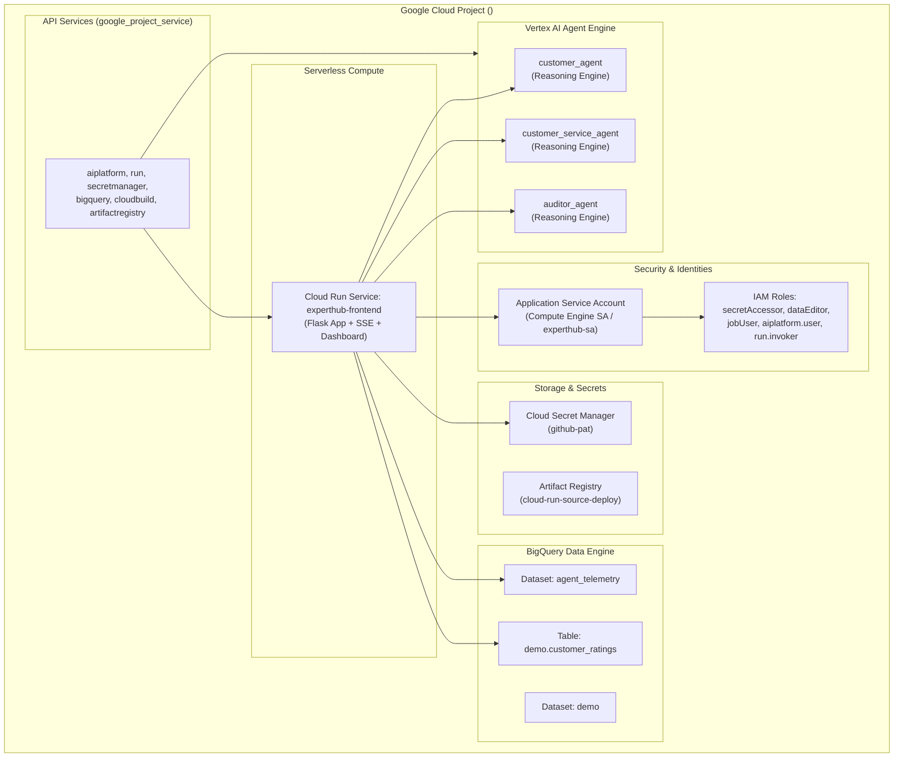

# Experthub Demo - Terraform Infrastructure as Code

This directory contains the complete **Terraform (HCL)** configuration to deploy the entire **ApexHome & Electro Self-Improving Agent System** demonstration on Google Cloud.

---

## 1. Architecture Overview & Provisioned Resources

The Terraform script declaratively defines, configures, and links all components required for the end-to-end demonstration:



### Resource Inventory:
1. **Google Cloud Services (`google_project_service`):**
   - Vertex AI (`aiplatform.googleapis.com`)
   - Cloud Run (`run.googleapis.com`)
   - Secret Manager (`secretmanager.googleapis.com`)
   - BigQuery (`bigquery.googleapis.com`)
   - Cloud Build (`cloudbuild.googleapis.com`)
   - Artifact Registry (`artifactregistry.googleapis.com`)
   - Resource Manager (`cloudresourcemanager.googleapis.com`)
   - Cloud IAM (`iam.googleapis.com`)
   - Cloud Storage (`storage.googleapis.com`)
2. **Service Account & IAM (`google_project_iam_member`):**
   - Configures least-privilege roles for runtime workloads:
     - `roles/secretmanager.secretAccessor`
     - `roles/bigquery.dataEditor`
     - `roles/bigquery.jobUser`
     - `roles/aiplatform.user`
     - `roles/run.invoker`
3. **Secret Manager (`google_secret_manager_secret`):**
   - `github-pat`: Stores GitHub Personal Access Token for automated Open Knowledge Format (OKF) dynamic context authoring and commits.
   - Secret access IAM policy binding for the compute workload.
4. **BigQuery Engine (`google_bigquery_dataset`, `google_bigquery_table`):**
   - Dataset `agent_telemetry`: Populated by ADK 2.0 `BigQueryAgentAnalyticsPlugin` with token counts, latencies, and tool calls.
   - Dataset `demo`: Dedicated dataset for application data.
   - Table `demo.customer_ratings`: Stores post-conversation CSAT ratings (1–5) and customer feedback (`customer_id`, `customer_name`, `rating`, `description`, `timestamp`).
5. **Artifact Registry (`google_artifact_registry_repository`):**
   - Docker container repository for Cloud Run frontend builds.
6. **Container Build & Agent Deployers (`null_resource` / provisioners):**
   - Automated Cloud Build trigger (`build_frontend_image`) for compiling and pushing the frontend image.
   - Automated deployment provisioners (`deploy_vertex_agents`) for registering Reasoning Engines to Vertex AI Agent Engine.
7. **Cloud Run Frontend (`google_cloud_run_v2_service`):**
   - Multi-container serverless runtime serving the Flask web application, Server-Sent Events (SSE) streaming engine, and analytics dashboard.
   - Includes CPU and memory resource bounds, environment variable injection, startup probe, and unauthenticated/invoker configuration.

---

## 2. File Structure

```text
terraform/
├── versions.tf               # Terraform requirements and Google provider definitions
├── variables.tf              # Input variables with descriptions, types, and defaults
├── main.tf                   # Primary resource declarations (APIs, IAM, BigQuery, Secrets, Cloud Run)
├── outputs.tf                # Deployment outputs (Cloud Run URL, dataset IDs, agent IDs)
├── terraform.tfvars          # Project-specific variable assignments
├── terraform.tfvars.example  # Reference variable template for other environments
└── README.md                 # This documentation file
```

---

## 3. Quick Start Deployment

### Prerequisites
- [Terraform](https://developer.hashicorp.com/terraform/downloads) ≥ v1.5.0 installed.
- [Google Cloud CLI (`gcloud`)](https://cloud.google.com/sdk/docs/install) authenticated:
  ```bash
  gcloud auth application-default login
  gcloud config set project <YOUR_PROJECT_ID>
  ```

### Automated Deployment Script
From the repository root, run `./deploy_terraform.sh`, which auto-detects your active `gcloud` / `GOOGLE_CLOUD_PROJECT` project or accepts `--project`:
```bash
./deploy_terraform.sh --project <YOUR_PROJECT_ID>
```

### Manual Terraform Execution
Alternatively, copy `terraform.tfvars.example` to `terraform.tfvars` (or pass `-var="project_id=<YOUR_PROJECT_ID>"`) from within the `terraform/` directory:
```bash
cp terraform.tfvars.example terraform.tfvars
terraform init
terraform plan -var="project_id=<YOUR_PROJECT_ID>"
terraform apply -var="project_id=<YOUR_PROJECT_ID>"
```

To run non-interactively in automated CI/CD pipelines:
```bash
terraform apply -auto-approve -var="project_id=<YOUR_PROJECT_ID>"
```

---

## 4. Configuration Variables

Variables can be customized in `terraform.tfvars` or supplied via command-line flags `-var="key=value"`:

| Variable | Type | Default | Description |
| :--- | :--- | :--- | :--- |
| `project_id` | `string` | *(required)* | GCP Project ID. |
| `region` | `string` | `"us-central1"` | GCP Region for Cloud Run, Artifact Registry, and Vertex AI. |
| `bq_location` | `string` | `"US"` | BigQuery location (`US` multi-region or regional). |
| `secret_name` | `string` | `"github-pat"` | Secret Manager secret name for GitHub token. |
| `github_pat` | `string` (sensitive) | `""` | GitHub Personal Access Token. |
| `use_existing_service_account`| `bool` | `true` | Use Compute Engine default SA instead of creating new SA. |
| `existing_service_account_email`| `string` | `""` *(auto-resolves `<number>-compute@...`)* | Email of existing service account. |
| `artifact_repository_id` | `string` | `"cloud-run-source-deploy"` | Artifact Registry Docker repository ID. |
| `frontend_service_name` | `string` | `"experthub-frontend"` | Name of Cloud Run frontend service. |
| `frontend_image` | `string` | `""` | Optional explicit container image URI. |
| `build_frontend_image` | `bool` | `false` | Build frontend container with Cloud Build during apply. |
| `deploy_vertex_agents` | `bool` | `false` | Trigger agent deployment scripts during apply. |
| `customer_service_agent_id` | `string` | `""` | Vertex AI Reasoning Engine ID for Customer Service Agent. |
| `customer_agent_id` | `string` | `""` | Vertex AI Reasoning Engine ID for Customer Simulator. |
| `auditor_agent_id` | `string` | `""` | Vertex AI Reasoning Engine ID for Auditor Agent. |
| `invoker_iam_disabled` | `bool` | `true` | Disable Cloud Run IAM check (allows public traffic in domain-restricted orgs). |
| `allow_public_allusers` | `bool` | `false` | Bind `allUsers` to `roles/run.invoker` if organization policy permits. |

---

## 5. Automated Build & Deploy Flags

If you are provisioning from scratch in a fresh GCP project, you can enable end-to-end building and agent staging via CLI flags (`./deploy_terraform.sh --build-image --deploy-agents`) or in `terraform.tfvars`:

```hcl
build_frontend_image = true
deploy_vertex_agents = true
```

When enabled:
1. Terraform triggers `gcloud builds submit` to package the root `Dockerfile` and push it to Artifact Registry.
2. Terraform triggers each component's `deploy.py` to register `customer_service_agent`, `customer_agent`, and `auditor_agent` in Vertex AI Agent Engine.
3. Terraform creates and starts the Cloud Run frontend pointing to the freshly built image and agent endpoints.

---

## 6. Outputs

Upon successful completion, Terraform displays key resource URIs:

```text
Outputs:

artifact_registry_repository = "cloud-run-source-deploy"
bigquery_datasets = {
  "agent_telemetry" = "agent_telemetry"
  "demo" = "demo"
}
customer_ratings_table = "demo.customer_ratings"
frontend_service_name = "experthub-frontend"
frontend_url = "https://experthub-frontend-<hash>-uc.a.run.app"
project_id = "<YOUR_PROJECT_ID>"
region = "us-central1"
secret_manager_github_pat = "projects/<PROJECT_NUMBER>/secrets/github-pat"
service_account_email = "<PROJECT_NUMBER>-compute@developer.gserviceaccount.com"
vertex_ai_agent_ids = {
  "auditor_agent" = ""
  "customer_agent" = ""
  "customer_service_agent" = ""
}
```

---

## 7. Verification

Verify the deployed frontend application:
```bash
# Health check endpoint
curl -s $(terraform output -raw frontend_url)/health

# Analytics KPI summary endpoint
curl -s $(terraform output -raw frontend_url)/api/analytics/summary
```

---

## 8. Teardown / Cleanup

To safely destroy the provisioned demo resources:
```bash
terraform destroy
```
*(Note: BigQuery datasets and Secret Manager secrets have deletion protections and retention safeguards enabled by default to prevent accidental data loss.)*
